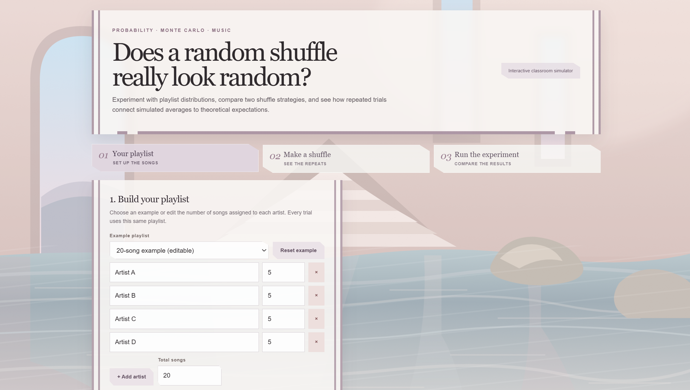
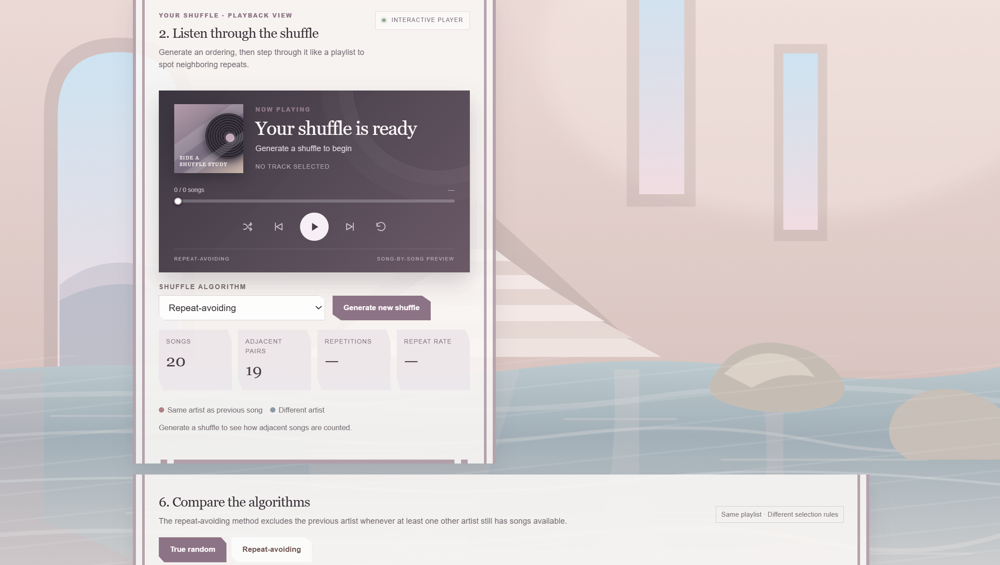
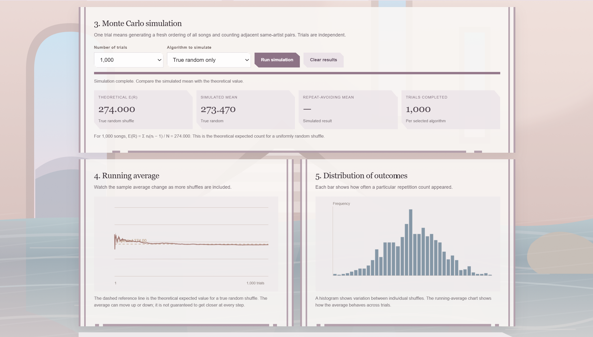

# Music Shuffle Simulator

An interactive browser-based application exploring music shuffle algorithms, probability, and Monte Carlo simulation.

## Project Overview

Does a truly random shuffle actually feel random?

Music listeners often expect shuffle algorithms to distribute songs by the same artist evenly throughout a playlist. However, consecutive songs by the same artist can naturally occur under true randomness.

This project investigates this phenomenon by comparing two shuffle algorithms through mathematical probability, computational experiments, and interactive data visualization.


## Live Demo

[Launch the Music Shuffle Simulator](https://yix-c011.github.io/music-shuffle-simulator/)

Try the interactive simulator directly in your browser. No installation required.


## Application Preview

### Playlist Editor

Customize artist distributions and create playlists for your experiments.



### Interactive Shuffle Player

Generate shuffles and visualize consecutive same-artist repetitions.



### Monte Carlo Simulation

Conduct thousands of trials, visualize statistical outcomes, and compare shuffle algorithms.




## Features

- Customizable playlists with adjustable artist distributions
- Built-in 20-song and 1,000-song example playlists
- True Random and Repeat-Avoiding shuffle algorithms
- Interactive music-player-inspired interface
- Visualization of consecutive same-artist repetitions
- Monte Carlo simulation with up to 10,000 trials
- Theoretical expected value calculations
- Running-average graphs and histograms
- Experimental comparison of shuffle algorithms
- Responsive interface with animated transitions

## Technologies Used

- HTML5 — Application structure
- CSS3 — Interface design, animations, and responsive layouts
- JavaScript — Shuffle algorithms and statistical simulations
- Canvas API — Interactive data visualization
- SVG — Illustrated background and interface graphics

The application runs entirely in the browser without requiring a backend, database, or external dependencies.

## Shuffle Algorithms

### True Random (Fisher–Yates)

Generates a uniformly random permutation of the playlist. Every individual song appears exactly once, while consecutive songs by the same artist may occur naturally.

### Repeat-Avoiding

Randomly selects from remaining songs belonging to artists different from the previously selected artist whenever possible.

If no alternative artist remains, a same-artist repetition is allowed.

This approach reduces consecutive-artist repetitions but does not produce uniformly random permutations or guarantee the minimum possible number of repetitions.

## Mathematical Foundation

The expected number of adjacent same-artist pairs under a uniformly random shuffle is:

E(R) = Σ nᵢ(nᵢ − 1) / N

Where:

- N is the total number of songs.
- nᵢ is the number of songs belonging to artist i.
- R is the number of adjacent same-artist repetitions.

Monte Carlo simulation estimates this expected value by repeatedly generating shuffles, counting repetitions, and calculating the sample average.

The running-average visualization demonstrates the Law of Large Numbers.

## Experimental Results

The following experiments used a playlist of 1,000 songs distributed among four artists.

|    Artist     | Songs |
|   --------    |  ---: |
| Taylor Swift  |  300  |
| Justin Bieber |  200  |
| Billie Eilish |  150  |
| Ariana Grande |  350  |
| Total         | 1,000 |

The theoretical expected number of repetitions under True Random is 274.

### Monte Carlo Simulation

| Trials | Theoretical Mean | Simulated Mean |
|  ---:  |    ----------:   |    --------:   |
| 10     |      274.000     |     281.100    |
| 100    |      274.000     |     270.880    |
| 1,000  |      274.000     |     274.070    |
| 10,000 |      274.000     |     274.103    |

### Algorithm Comparison

A separate experiment using 10,000 trials per algorithm produced:

|    Algorithm    | Average Repetitions |
|    ---------    |   ---------------:  |
| True Random     |       274.006       |
| Repeat-Avoiding |       11.946        |

Repeat-Avoiding reduced consecutive same-artist repetitions by approximately 95.64% in this experiment.

Results vary between simulation runs due to randomness.

## Limitations

- Repeat-Avoiding cannot always eliminate consecutive-artist repetitions.
- Unequal artist distributions can affect algorithm performance.
- Reducing repetitions does not establish that listeners perceive the shuffle as more random.
- Human perception would require additional user testing.

## How to Run Locally

1. Download or clone this repository.
2. Open index.html in a modern web browser.
3. Configure a playlist.
4. Choose a shuffle algorithm.
5. Generate a shuffle or run a Monte Carlo simulation.

No installation or additional configuration is required.

## Project Structure

```
music-shuffle-simulator/
├── screenshots/
│   ├── playlist.png
│   ├── shuffle.png
│   └── simulation.png
├── index.html
└── README.md
```


## Learning Outcomes

This project explores:

- Randomized algorithms
- Monte Carlo methods
- Probability and expected value
- The Law of Large Numbers
- Statistical data visualization
- Front-end web development
- Interactive user interface design

## Academic Context and Contributions

This simulator was developed as part of a collaborative Probability and Statistics for Computer Science course project at The City College of New York.

My contribution focused on the interactive simulator, computational experiments, Monte Carlo simulation, data visualization, and presentation of experimental findings.

AI-assisted development was used during implementation, interface design, debugging, and documentation.

## Future Improvements

- Custom song titles and playlist imports
- Additional shuffle algorithms
- Side-by-side distribution comparisons
- Exportable simulation results
- Improved artist distribution strategies
- Human perception experiments
